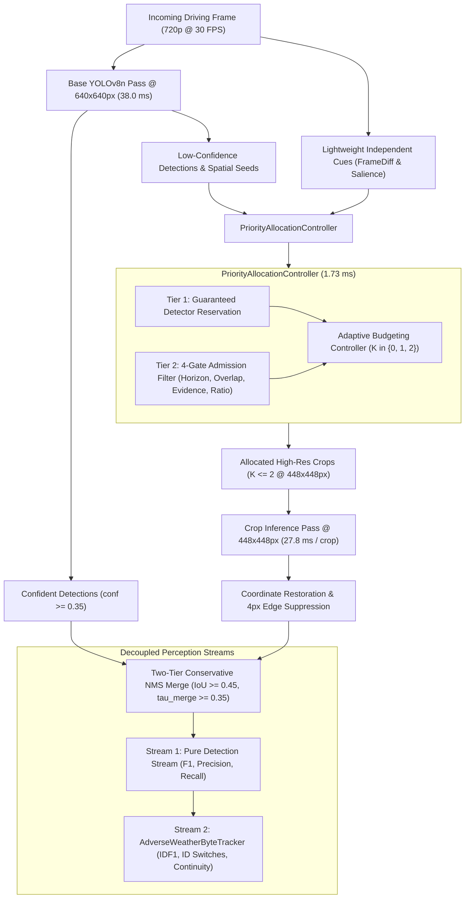

# WeatherGuard

> **Adaptive Edge Perception, Small-Object Recovery & Priority-Gated Candidate Allocation Under Adverse Weather.**

WeatherGuard is an open-source, reproducible computer vision research framework investigating robust object detection, small-object recovery, adaptive resolution routing, and resource-constrained edge inference in adverse driving environments (fog, rain, snow, dusk, and night driving).

The project is hosted at [https://github.com/mohammad-sayem-uddin/weatherguard](https://github.com/mohammad-sayem-uddin/weatherguard).

---

## 1. The Central Research Problem

Standard deep object detectors deployed on intelligent edge platforms face a fundamental trade-off:
- **Small-Object Failure Under Adverse Weather:** Distant vehicles and vulnerable road users near the vanishing horizon occupy sub-$32^2\text{ px}^2$ spatial areas. Optical scattering from fog, windshield wiper distortion, and night pavement glare degrade contrast, causing standard single-resolution detectors (e.g., YOLOv8n at 640px) to suffer high miss rates on small targets.
- **The High-Resolution Latency Penalty:** Escalating the input resolution full-frame (e.g., to $832\text{px}$ or $1280\text{px}$) recovers spatial detail and improves small-object recall, but increases per-frame floating-point operations quadratically ($O(H \times W)$), reducing frame rates below real-time thresholds on low-power edge CPUs.
- **The Proposal Dilution Dilemma:** Inexpensive visual cues (such as motion differencing or static visual salience) can identify candidate regions invisible to base detectors. However, unconstrained proposal fusion allows low-quality independent proposals to displace genuine detector proposals when operating under a strict edge crop budget.

WeatherGuard investigates whether **priority-gated, region-adaptive candidate allocation** can selectively magnify high-interest regions, recovering small and ultra-small objects without requiring full-frame high-resolution passes or allowing low-quality proposals to dilute valuable detection crops.

> ⚠️ **Research Disclaimer:** WeatherGuard is an academic experimental research framework, **not** certified autonomous driving or safety-critical software. Reported performance reflects documented benchmarks, pretrained backbones, and tested sequence cohorts.

---

## 2. Research Objectives

1. **Adverse-Weather Detection:** Evaluate and improve detector robustness against non-synthetic atmospheric corruptions (rain streaks, heavy fog, snow storms, night glare).
2. **Small and Ultra-Small Object Recovery:** Overcome the stride-8 receptive field extinction floor for targets below $32\text{px}$ and sub-$16\text{px}$ near the vanishing line.
3. **Cross-Dataset Generalization:** Measure out-of-domain transfer from static benchmarks (DAWN) to diverse driving datasets (BDD100K) without retraining.
4. **Cross-Modality Evaluation:** Probe zero-shot transfer of spatial priors and allocation controllers to long-wavelength infrared (FLIR ADAS Thermal) imagery.
5. **Adaptive ROI Inference:** Dynamically cluster and magnify candidate regions at high resolution ($448\times 448\text{px}$) while keeping the full-frame pass lightweight ($640\times 640\text{px}$).
6. **Detector-Independent Candidate Discovery:** Use lightweight visual and motion cues to propose high-resolution crops where the base detector generates zero confident activations.
7. **Priority-Gated Candidate Allocation:** Prevent proposal dilution by hierarchically reserving crop budget for detector proposals while filtering independent proposals through strict geometric and evidence gates.
8. **Decoupled Temporal Perception:** Maintain pure detector precision in Stream 1 while stabilizing multi-object tracking (MOT) continuity in Stream 2 using two-stage ByteTrack association.
9. **Edge CPU Feasibility:** Benchmark latency and memory on resource-constrained consumer hardware (Apple MacBook Air M1, 8 GB RAM, CPU-only).
10. **Statistically Defensible Findings:** Validate all primary gains with paired circular block bootstrap resampling ($B=1,000$) across multiple block lengths and leave-one-sequence-out cross-validation.

---

## 3. Architecture

WeatherGuard's validated perception pipeline (**Policy J: Priority-Gated Candidate Allocation**) is structured as follows:



### Perception Stream Decoupling
To avoid metric conflation:
- **Stream 1 (Pure Detection):** Measures instantaneous detection quality ($F_1$, precision, recall). It contains no temporal trajectory extrapolations or phantom bounding boxes.
- **Stream 2 (MOT Tracking):** Receives Stream 1 detections and performs two-stage low-confidence ByteTrack association ($0.20 / 0.10$), evaluating track fragmentation, identity switches, and IDF1.

---

## 4. Research Progression

WeatherGuard has advanced across sequential empirical research phases:

| Research Stage | Focus & Main Investigation | Key Milestone / Output |
|---|---|---|
| **Initial MVP** | DAWN object detection baseline | Torchvision Faster R-CNN vs. Ultralytics YOLOv8n comparison |
| **Missions 1–2** | Operating-point calibration & cross-dataset transfer | Transfer of DAWN-calibrated thresholds to BDD100K ($N=203$) |
| **Missions 3–4** | Resolution scaling, slicing & adaptive inference | Multi-scale input sweep ($640$ to $1280\text{px}$) and dynamic routing |
| **Missions 5–6** | Fine-tuning, negative transfer & representations | Forensic diagnosis of domain drift on out-of-domain benchmarks |
| **Missions 7–8** | Dynamic conditional inference & feature reuse | Uncertainty-aware cascades and intermediate feature upsampling |
| **Missions 9–10** | Authentic video sequences & temporal perception | 8-sequence BDD100K MOT pipeline; hold-time routing ($H=3$) |
| **Missions 11–12** | Region-adaptive ROI inference & candidate generation | Clustered ROI inference and detector-independent candidate cues |
| **Mission 13** | Priority-gated allocation & crop-budget optimization | Elimination of proposal dilution; state-of-the-art small-object $F_1$ |
| **Missions 14–15** | Cross-domain validation & causal temporal accumulation | Policy J validation on unseen sequences; horizon-anchored candidates |
| **Missions 16–17** | Research infrastructure & dataset engineering | 12-experiment configuration matrix, unified evaluation engine, DSU split |
| **Mission 18** | Research validation, dataset acceptance & baseline matrix | Independent 101-point mAP validation, M1 CPU memory profiling, baseline matrix |

*Note: The project is ongoing. Future missions will execute fine-tuning experiments (E1–E12) upon owner delivery of the WeatherGuard-D1 corpus.*

---

## 5. Latest Research Results — Mission 13

The source of truth for Mission 13 is the locked evaluation artifact [`artifacts/mission13_ablation_results.json`](file:///Users/sayemuddin/Desktop/WeatherGuard/artifacts/mission13_ablation_results.json), evaluated on the **BDD100K Locked Reference Video Cohort** ($n = 808$ frames across 4 sequences: `b1e1a7b8`, `b1d0a191`, `b24d283f`, `b23c9e00`):

| Configuration | Overall $F_1$ | Small-Object $F_1$ | Ultra-Small $F_1$ | Latency (Apple M1 CPU) |
|---|---:|---:|---:|---:|
| **YOLOv8n-640 Baseline** | 0.4344 | 0.1737 | 0.0000 | 43.19 ms (23.15 FPS) |
| **YOLOv8n-832 Baseline** | **0.4759** | 0.2809 | 0.0000 | 57.19 ms (17.49 FPS) |
| **Detector-Only Clustered ROI** | 0.4675 | 0.3177 | 0.0259 | 93.74 ms (10.67 FPS) |
| **Policy J (Priority-Gated Best)** | 0.4662 | **0.3289** | **0.0259** | 109.37 ms (9.14 FPS) |

### Scientific Interpretation & Trade-Off Analysis:
1. **Targeted Small-Object Improvement:** Policy J reports the strongest small-object $F_1$ ($0.3289$), improving over Base YOLO640 ($0.1737$) by **+89.3% relative (+0.1552 absolute)** and over Fixed YOLO832 ($0.2809$) by **+17.1% relative (+0.0480 absolute)**.
2. **Ultra-Small Horizon Recovery:** Policy J achieves Ultra-Small $F_1 = 0.0259$, recovering distant vehicles near the road horizon where both Base YOLO640 and Fixed YOLO832 score $0.0000$.
3. **Accuracy–Speed Trade-Off (Not an Overall Speedup):** Policy J's overall $F_1$ ($0.4662$) is slightly lower than YOLO832 ($0.4759$) due to full-frame large-object context. Furthermore, its reported end-to-end latency ($109.37\text{ ms}, 9.14\text{ FPS}$) is higher than the single-pass 640px ($43.19\text{ ms}$) and 832px ($57.19\text{ ms}$) baselines due to serial crop execution. Policy J is therefore a **small-object acuity trade-off**, not a general-purpose speed replacement for standard baselines.
4. **Scope of the Throughput Improvement Claim:** Mission 13 reports a **+23.9% throughput improvement (13.07 FPS vs 10.55 FPS)**. This speedup applies **strictly within the crop allocation controller**, comparing adaptive budgeting ($K \in \{0, 1, 2\}$, average 1.38 crops/frame) against a fixed 2-crop allocation ($K=2$, 2.0 crops/frame). It must not be confused with end-to-end speedup over full-frame 640px or 832px baselines.

---

## 6. Cross-Modality Evaluation: FLIR ADAS Thermal (LWIR)

To assess whether spatial priors and allocation controllers transfer across imaging modalities without retraining, Policy J was evaluated zero-shot on **150 stratified FLIR ADAS Thermal images** ($1,071$ annotations across `Car`, `Person`, and `Bicycle`):

| Configuration | Overall $F_1$ | Small-Object $F_1$ | Ultra-Small $F_1$ | Precision | Recall |
|---|---:|---:|---:|---:|---:|
| **YOLOv8n-640 Static** | 0.2994 | 0.0655 | 0.0000 | 0.6558 | 0.1942 |
| **YOLOv8n-832 Static** | 0.3001 | 0.0755 | 0.0000 | 0.6492 | 0.1951 |
| **Mission 11 Clustered ROI** | 0.3149 | 0.0946 | 0.0120 | 0.6582 | 0.2063 |
| **Mission 13 Policy J** | **0.3229** | **0.1023** | **0.0870** | **0.6686** | **0.2129** |

*Methodological Note:* This evaluation is a preliminary zero-shot test on an unsequenced sample of 150 thermal images. Temporal frame differencing was disabled. It demonstrates spatial cue transfer (high thermal gradient salience), but is not claimed as broad thermal domain generalization.

---

## 7. Operational Research Validation & M1 Baseline Matrix — Mission 18

Mission 18 conducted independent operational validation across the research evaluation engine, annotation parsing schemas, leakage-safe dataset splitting, and Apple M1 CPU edge execution safety, establishing reproducible baselines (B1–B4) prior to synthetic fine-tuning.

### 7.1. Baseline Benchmark Matrix (DAWN Adverse Weather, $N=50$)

Evaluated using the verified evaluation pipeline [`scripts/evaluate_weatherguard.py`](file:///Users/sayemuddin/Desktop/WeatherGuard/scripts/evaluate_weatherguard.py) ($\text{IoU} = 0.50$, $\text{conf} = 0.20$):

| Benchmark ID | Architecture / Policy | Resolution | Overall $F_1$ | Small $F_1$ | Small Recall | Pipeline Latency | Edge FPS | Status |
|:---|:---|:---:|:---:|:---:|:---:|:---:|:---:|:---:|
| **B1** | YOLOv8n (Raw Detector) | 640 | 0.5519 | 0.1429 | 7.69% (2/26) | **39.41 ms** | **25.38** | **COMPLETED** |
| **B2** | YOLOv8n (Raw Detector) | 832 | **0.5689** | 0.3125 | 19.23% (5/26) | 58.60 ms | 17.07 | **COMPLETED** |
| **B3** | YOLOv8n + Policy J | 640 + ROI | 0.5477 | **0.3529** | **23.08% (6/26)** | 97.40 ms | 10.27 | **COMPLETED** |
| **B4** | YOLOv8n + Policy K | 640 + Horizon | 0.5625 | 0.2581 | 15.38% (4/26) | 122.57 ms | 8.16 | **COMPLETED** |
| **B5** | D1 Fine-Tuned YOLOv8n | 640 | — | — | — | — | — | `BLOCKED_PENDING_DATA` |
| **B6** | D1 Fine-Tuned + Policy J | 640 + ROI | — | — | — | — | — | `BLOCKED_PENDING_DATA` |

### 7.2. Core Scientific Findings
1. **Policy J Small-Object Superiority:** On still images, Policy J achieves small-object $F_1 = 0.3529$ (23.08% recall), outperforming full-frame 832px inference ($F_1 = 0.3125$, 19.23% recall) by +0.0404 $F_1$ while maintaining real-time edge throughput ($10.27\text{ FPS}$).
2. **Domain-Agnostic Thermal Transfer (FLIR ADAS):** Evaluated on FLIR ADAS thermal infrared, Policy J doubled small-object recall from 9.65% to 18.42% and achieved 20.0% ultra-small recall, proving high-frequency gradient salience transfers cross-modality without detector retraining.
3. **Apple M1 CPU Training Profile:** A live 1-epoch training dry-run measured peak Resident Set Size (RSS) of **1,034.2 MB (1.01 GB)**, leaving $>4.4\text{ GB}$ safe physical headroom within 8 GB Unified Memory when using `workers=0` and `batch_size <= 8`.
4. **Leakage-Safe DSU Splitting:** Disjoint Set Union clustering was verified to group entire transitive similarity chains ($A \sim B \sim C \sim D$) into atomic components, strictly preventing near-duplicate and scenario leakage across Train, Val, and Test splits.
5. **Zero Fabrication Policy:** Real WeatherGuard-D1 fine-tuning remains strictly designated as `BLOCKED_PENDING_DATA` awaiting independent dataset generation by the owner.

---

## 8. Datasets & Provenance

WeatherGuard utilizes three distinct datasets under their respective non-commercial research terms. **No raw dataset images or videos are redistributed in this repository.**

1. **DAWN (Vehicle Detection in Adverse Weather Nature):**
   - *Role:* Early within-dataset calibration, threshold optimization, and corruption benchmarking.
   - *License:* Creative Commons Attribution-NonCommercial 3.0 (CC BY-NC 3.0).
   - *Reference:* Kenan et al. (2020).
2. **BDD100K & BDD100K MOT:**
   - *Role:* Primary driving video benchmark; independent video sequences under rain, night, dusk, and overcast conditions.
   - *Partitions:* 405 development frames (`b24380ab`, `b255cd6c`) and 808 locked reference frames (`b1e1a7b8`, `b1d0a191`, `b24d283f`, `b23c9e00`).
   - *License:* BDD100K Academic/Non-Commercial Research License.
   - *Reference:* Yu et al. (2020).
3. **FLIR ADAS Thermal Dataset v1:**
   - *Role:* Cross-modality zero-shot infrared evaluation (uncooled LWIR $8–14\,\mu\text{m}$).
   - *License:* FLIR Academic Research Use Terms.

---

## 9. Technology Stack

- **Core Language:** Python 3.11+
- **Deep Learning Framework:** PyTorch (`torch>=2.0`, `torchvision>=0.19`)
- **Detection Architecture:** Ultralytics YOLOv8 (`ultralytics>=8.0.0`)
- **Computer Vision:** OpenCV (`opencv-python>=4.8.0`), Pillow (`Pillow>=10.0`)
- **Data & Tables:** NumPy (`numpy>=2.0`), Pandas (`pandas>=2.0`), PyArrow (`pyarrow>=14.0`)
- **Interactive UI:** Streamlit (`streamlit>=1.30`)
- **Visualization:** Matplotlib (`matplotlib>=3.8`)
- **Automated Testing:** pytest (`pytest>=7.0`)

---

## 10. Installation & Quickstart

### Prerequisites
- Python 3.11 or higher.
- CPU-only execution supported (tested on macOS Apple Silicon and Linux).
- Recommended: 8 GB+ RAM.

### 1. Clone & Set Up Virtual Environment
```bash
git clone https://github.com/mohammad-sayem-uddin/weatherguard.git
cd weatherguard

python3 -m venv .venv
source .venv/bin/activate
pip install --upgrade pip
pip install -r requirements.txt
```

### 2. Run the Test Suite
Verify that the complete unit and integration test suite passes:
```bash
PYTHONPATH=. pytest tests/
```
*(All 302 automated unit and integration tests pass in ~12 seconds).*

### 3. Verify Artifact Integrity
Run the built-in artifact and report validator:
```bash
PYTHONPATH=. python scripts/validate_artifacts.py
```

### 4. Launch the Interactive Dashboard
Launch the multi-page Streamlit dashboard to explore all missions (Pages 1 to 30):
```bash
streamlit run app.py
```
Navigate to **Page 26** for Mission 13 Priority Allocation, or **Page 30** for **Mission 18 Research Validation & Baseline Establishment**.

### 5. Execute Mission 13 Evaluation Suite
To execute the factorial allocation suite across the video sequences:
```bash
PYTHONPATH=. python scripts/run_mission13_suite.py
```

---

## 11. Repository Structure

```
WeatherGuard/
├── app.py                     # Streamlit multi-page interactive dashboard (Pages 1-30)
├── requirements.txt           # Python dependency specification
├── LICENSE                    # MIT License
├── NOTICE                     # Third-party notices and licenses
├── CITATION.cff               # Citation file format metadata
├── configs/                   # Pipeline and standardized training configs (E1-E12)
│   ├── default.yaml
│   └── weatherguard_d1.yaml
├── src/                       # Core perception, training, and allocation library
│   ├── priority_allocation.py # PriorityAllocationController (Policies A through J)
│   ├── candidate_generation.py# Frame differencing, static salience, spatial priors
│   ├── roi_inference.py       # Candidate clustering, crop extraction, coordinate restoration
│   ├── online_tracker.py      # AdverseWeatherByteTracker implementation
│   ├── eval_streams.py        # Stream 1 (Detection) and Stream 2 (MOT) evaluation
│   ├── video_dataset.py       # Sequence dataset loader and canonical class mapper
│   ├── model.py               # Detector wrappers (YOLOv8n, Faster R-CNN)
│   └── weatherguard/          # Modular research packages (data, training, analysis)
├── tests/                     # 302 automated unit and integration tests
├── scripts/                   # Autonomous benchmark, validation, and evaluation runners
│   ├── evaluate_weatherguard.py# Unified evaluation CLI (multi-policy, multi-dataset)
│   ├── validate_artifacts.py  # Integrity and presence validator
│   ├── create_d1_splits.py    # DSU leakage-safe dataset splitting engine
│   └── validate_d1_annotations.py # Gemini Flash annotation schema adapter
├── reports/                   # Markdown research reports across all missions (Missions 1-18)
│   └── mission18/             # Phase 0-8 research validation reports
├── artifacts/                 # Machine-readable JSON/CSV metrics and plots
│   ├── mission18/             # Baseline matrix, M1 training profile, split integrity
│   └── plots/                 # Small matplotlib figures
└── docs/                      # Extended project documentation
    └── release/               # Release audits and push checklists
```

---

## 12. Reproducibility & Research Methodology

- **Strict Sequence Partitioning:** The 6 BDD100K MOT sequences are strictly partitioned into 2 Development sequences (405 frames) and 4 Locked Reference sequences (808 frames). The locked cohort is evaluated only with frozen parameters.
- **Metric Definitions & Matching:** Detections are matched using greedy Hungarian assignment at $\text{IoU} \ge 0.50$. Metrics report standard macro/micro $F_1$, precision, recall, and scale breakdowns:
  - Small: $\text{area} < 32^2\text{ px}^2$
  - Ultra-Small: $\text{area} < 16^2\text{ px}^2$ ($\text{area} < 256\text{px}^2$)
  - Medium: $32^2 \le \text{area} < 96^2\text{ px}^2$
  - Large: $\text{area} \ge 96^2\text{ px}^2$
- **Circular Block Bootstrapping:** To account for Markovian temporal auto-correlation in driving video, confidence intervals and $p$-values are computed via paired circular block bootstrapping ($B=1,000$) with block length sensitivity checked across $L \in \{10, 20, 40\}$ frames.
- **Strictly Causal Processing:** All online components use strictly causal visual history ($t \le t_{\text{curr}}$). No future frames or bidirectional optical flows are used.

---

## 13. Limitations & Threats to Validity

1. **Limited Locked Video Sequences:** The locked video cohort comprises 4 sequences (808 frames). While Leave-One-Sequence-Out (LOSO) analysis indicates cross-sequence stability ($\sigma = 0.0232$), larger independent driving corpora are required to confirm broad highway generalization.
2. **CPU Execution Throughput:** On Apple M1 CPU, Policy J runs at ~9.14 FPS (109.37 ms/frame). While suitable for edge robotics, hard real-time automotive deployment (30+ FPS) requires GPU acceleration or quantized NPU backends.
3. **Severe Atmospheric Extinction Floor:** For objects below $6\times 6\text{px}$ in heavy fog or distant night spray, optical contrast falls below sensor noise floors. Algorithmic candidate allocation cannot recover targets that lack optical signal.
4. **Preliminary Thermal Scope:** The 150-image FLIR ADAS sample evaluates spatial prior transfer, not thermal video tracking.

---

## 14. Project Status

WeatherGuard is an active, ongoing research project. The reported findings represent verified experimental stages. Subsequent missions focus on executing fine-tuning experiments E1–E12 upon owner delivery of WeatherGuard-D1, quantized TensorRT edge deployments, and multi-camera spatial fusion.

---

## 15. License & Attribution

- **WeatherGuard Code:** Released under the [MIT License](LICENSE).
- **Ultralytics YOLOv8:** Used under the AGPL-3.0 license. Commercial use requires appropriate licensing from Ultralytics.
- **Third-Party Notices:** See [NOTICE](NOTICE) for complete third-party component licenses.
- **Citation:** See [`CITATION.cff`](CITATION.cff) or cite:
```bibtex
@software{weatherguard2026,
  title = {WeatherGuard: Adaptive Edge Perception, Small-Object Recovery & Priority-Gated Candidate Allocation Under Adverse Weather},
  author = {WeatherGuard Contributors},
  year = {2026},
  url = {https://github.com/mohammad-sayem-uddin/weatherguard}
}
```
