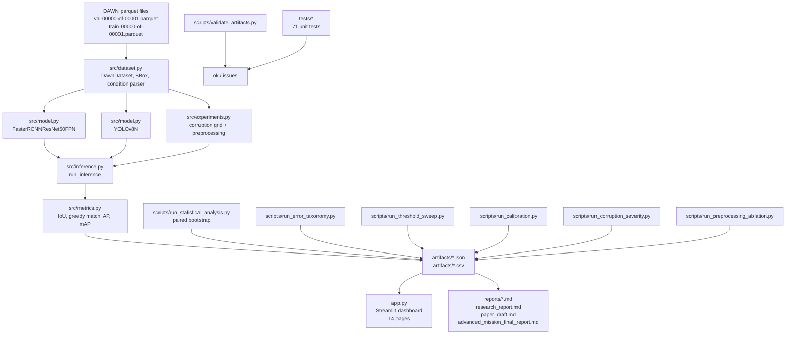

# WeatherGuard

> **A reproducible, CPU-friendly computer-vision toolkit for evaluating
> pretrained object detectors on real adverse-weather traffic imagery.**

WeatherGuard runs the public [DAWN](https://huggingface.co/datasets/Maxim37/dawn-dataset)
adverse-weather benchmark through openly licensed **pretrained** object
detectors (Torchvision Faster R-CNN, Ultralytics YOLOv8n) and reports
standard detection metrics, per-condition breakdowns, an explicit
detection error taxonomy, controlled image-corruption severity curves,
a paired-bootstrap statistical analysis, and a confidence-calibration
audit. **No training is performed** — all detections come from existing
COCO-pretrained weights.

> ⚠️ This is a research project. It is **not** a validated production
> autonomous-driving system. Numbers in this repository are limited to
> the DAWN val split (206 images, six classes) and the documented
> evaluation protocol.

---

## Key features

- **DAWN benchmark integration.** Reads the DAWN parquet files directly
  via `pyarrow`; no preprocessing. Weather condition is parsed from
  the `image_id` prefix.
- **Two off-the-shelf detectors.** Torchvision Faster R-CNN ResNet-50
  FPN (BSD-3-Clause) and Ultralytics YOLOv8n (AGPL-3.0).
- **Weather-condition analysis.** mAP, precision, recall, and F1
  per condition for every detector.
- **Statistical reliability.** 500-replicate paired image-level
  bootstrap on the full val set, including paired detector
  differences and per-corruption paired mAP-drop CIs.
- **Detection error taxonomy.** Explicit categorisation of every
  prediction (TP, Localization, Class_confusion, Duplicate, FP_other)
  with a confusion matrix, size stratification, and condition
  breakdown.
- **Confidence-threshold sweep.** 18-threshold P/R/F1/mAP curves for
  both detectors, with validation-selected operating points.
- **Corruption robustness laboratory.** Four photometric corruption
  families (blur, Gaussian noise, brightness reduction, contrast
  reduction) at multiple severities, on a fixed stratified subset.
- **Preprocessing ablation.** Light CLAHE, mild gamma, and light
  Gaussian smoothing compared against the identity baseline.
- **Calibration audit.** Brier score, 10-bin reliability tables, and
  single-parameter temperature scaling with a 50/50 split-half
  evaluation.
- **Interactive dashboard.** A 14-page Streamlit application
  (`app.py`) that reads every result file directly — no hardcoded
  metrics, no fabricated numbers.
- **Automated tests.** 71 unit tests covering dataset parsing,
  metrics, postprocessing, corruption correctness, error taxonomy,
  threshold sweep, and calibration utilities.
- **Experiment registry and validator.** Every experiment is recorded
  with timestamp, git commit, detector, configuration, and pointer to
  result artifacts. A validator script (`scripts/validate_artifacts.py`)
  confirms that all referenced artifacts exist.

---

## Architecture



`src/dataset.py` parses the parquet, decodes JPEG bytes, normalises
bounding boxes to the COCO `[x_min, y_min, w, h]` format, and exposes a
deterministic / stratified sampling API. `src/model.py` wraps each
pretrained detector behind a uniform `predict(image)` API and
normalises COCO labels into the 6-class DAWN label space via
`COCO_TO_DAWN`. `src/metrics.py` is the **only** file that defines the
IoU / matching / AP protocol; every other script calls into it.

---

## Dataset

- **Source:** [DAWN](https://huggingface.co/datasets/Maxim37/dawn-dataset)
  on Hugging Face.
- **Splits:** train (821 images, ~101 MB) and val (206 images, ~33 MB),
  shipped as two Apache Parquet files.
- **Schema:** `image_id` (string), `image` (struct of `bytes` + `path`),
  `width` (int64), `height` (int64), `objects` (list of
  `{class, class_name, x_min, y_min, width, height}`).
- **Classes (6):** `Truck`, `Person`, `Bicycle`, `Car`, `Motorcycle`,
  `Bus`. Class ids are DAWN-specific and **do not** match COCO ids;
  the dashboard maps detector COCO labels into the DAWN space via
  `COCO_TO_DAWN` in `src/dataset.py`.
- **Weather conditions (9):** `snow_storm`, `rain_storm`, `sand_storm`,
  `haze`, `foggy`, `mist`, `dusttornado`, `sand_storm_g2`,
  `sand_storm_g2_`. Conditions are encoded as the `image_id` prefix
  before the first `-`. The two `sand_storm_g2*` variants are
  preserved verbatim from the source.
- **License:** **CC BY-NC 3.0** (non-commercial research use only).
  No images are redistributed in this repository. Attribution is
  preserved in `CITATION.cff` and `NOTICE`.

To obtain the dataset, follow the Hugging Face link above and download
`train-00000-of-00001.parquet` and `val-00000-of-00001.parquet` into
the project root. They are not committed.

---

## Models

| Detector | Framework | Code licence | Pretrained weights | Notes |
|---|---|---|---|---|
| Faster R-CNN ResNet-50 FPN | Torchvision | BSD-3-Clause | COCO 2017 (Torchvision model registry) | Default detector. Fully permissive path. |
| YOLOv8n (optional) | Ultralytics | AGPL-3.0 | AGPL-3.0 | Optional. **Commercial use requires a separate Ultralytics licence.** |

Both detectors are used zero-shot. No fine-tuning. See `NOTICE` for
full third-party license attributions.

---

## Prerequisites

- **macOS** (Apple Silicon recommended; the project was developed on
  a MacBook Air M1 with 8 GB RAM).
- **Python 3.11** (3.10 also works; the project venv was created
  with `/opt/homebrew/bin/python3.11`).
- **Disk:** at least ~2 GB free for the virtual environment and the
  Ultralytics/YOLOv8n dependencies.
- **No GPU required.** Everything runs on the local CPU.
- **No paid APIs or cloud services.**

## Installation

```bash
# 1. Clone (do this manually) and enter the project directory
cd /Users/sayemuddin/Desktop/WeatherGuard

# 2. Create a Python 3.11 virtual environment
python3.11 -m venv .venv
.venv/bin/pip install --upgrade pip

# 3. Install the required dependencies (CPU-only PyTorch is sufficient)
.venv/bin/pip install -r requirements.txt

# 4. OPTIONAL: install Ultralytics for the YOLOv8n comparison path
#    (AGPL-3.0 — commercial use requires a separate Ultralytics licence)
.venv/bin/pip install ultralytics

# 5. Place the DAWN parquet files in the project root.
#    Do NOT commit them; they are excluded by .gitignore.
ls -la *.parquet
# train-00000-of-00001.parquet   val-00000-of-00001.parquet
```

`requirements.txt` pins only major-version constraints. The
project has been verified end-to-end on Python 3.11.15 with
PyTorch 2.14.1 (CPU), Torchvision 0.29.1, Streamlit 1.65, and
Ultralytics 8.4.

## Run the dashboard

```bash
PYTHONPATH=. .venv/bin/streamlit run app.py
# Then open http://localhost:8501 in your browser.
```

The dashboard has 14 pages. Each page reads real result files from
`artifacts/`. If a result file is missing, the page says so and
points at the exact command to produce it.

## Run the tests

```bash
PYTHONPATH=. .venv/bin/python -m unittest discover -s tests
```

The test suite currently runs 71 tests; the count is reported by
`unittest` at the end of the run.

## Run the experiments

The full set of commands to reproduce every result in `artifacts/` and
`reports/` is documented in §[Reproducibility](#reproducibility) below.

---

## Headline results

All numbers below are read directly from `artifacts/*.json` /
`artifacts/*.csv`. They are computed on the 206-image DAWN val split
using the protocol in `src/metrics.py` (IoU 0.5, score 0.5 unless
stated otherwise).

### Detector comparison on full val (n = 206)

| Detector | mAP@.5 | 95% paired bootstrap CI | Micro P | Micro R | Micro F1 | Mean ms/img | Median ms/img |
|---|---:|---|---:|---:|---:|---:|---:|
| Faster R-CNN R50 | 0.410 | [0.34, 0.52] | 0.662 | 0.659 | 0.660 | 1431 | 1266 |
| YOLOv8n | 0.192 | [0.16, 0.25] | 0.902 | 0.328 | 0.481 | 108 | 99 |

The paired mAP@.5 difference (Faster R-CNN − YOLOv8n) is +0.217 with
95% CI [+0.15, +0.30], which does not straddle zero. This is
consistent with a robust detector-ordering effect at the
image-resampling level, not a population-level claim.

### Per-class AP@.5 (Faster R-CNN)

| Class | n GT | AP@.5 | P | R | F1 |
|---|---:|---:|---:|---:|---:|
| Car | 1161 | 0.651 | 0.737 | 0.693 | 0.714 |
| Person | 111 | 0.704 | 0.506 | 0.748 | 0.604 |
| Motorcycle | 15 | 0.520 | 0.727 | 0.533 | 0.615 |
| Bus | 34 | 0.371 | 0.636 | 0.412 | 0.500 |
| Truck | 115 | 0.212 | 0.271 | 0.330 | 0.298 |
| Bicycle | 2 | 0.000 | 0.000 | 0.000 | 0.000 |

Bicycle has only 2 GT instances in the val split; its 0.000 AP is
**uninformative** rather than a claim about bicycle detection
performance.

### Per-condition mAP@.5 (Faster R-CNN)

| Condition | n | mAP@.5 | 95% bootstrap CI |
|---|---:|---:|---|
| snow_storm | 47 | 0.627 | [0.47, 0.78] |
| sand_storm | 40 | 0.544 | [0.40, 0.69] |
| dusttornado | 9 | 0.478 | [0.30, 0.77] (exploratory, n<15) |
| sand_storm_g2_ | 9 | 0.485 | [0.31, 0.64] (exploratory, n<15) |
| foggy | 19 | 0.401 | [0.12, 0.67] |
| rain_storm | 46 | 0.362 | [0.28, 0.54] |
| haze | 18 | 0.336 | [0.24, 0.50] |
| mist | 18 | 0.299 | [0.24, 0.56] |

### Controlled corruption severity (Faster R-CNN, 40 stratified images)

| Family | Best mAP@.5 | Worst mAP@.5 | Range |
|---|---:|---:|---:|
| Blur r=1..8 | 0.519 (r=1) | 0.038 (r=8) | −0.481 |
| Gaussian noise σ=5..50 | 0.539 (σ=5) | 0.132 (σ=50) | −0.407 |
| Brightness 0.9..0.15 | 0.552 (0.9) | 0.266 (0.15) | −0.286 |
| Contrast 0.9..0.15 | 0.551 (0.9) | 0.233 (0.15) | −0.318 |

All four families are **monotonically** degrading in the tested
parameter ranges. Paired bootstrap 95% CIs for the mAP drop at
moderate severity (blur r=4, noise σ=25) do not straddle zero.
Photometric corruptions are **not** equivalent to real adverse
weather.

### Calibration (Brier score, lower is better)

| Detector | Brier (raw) | T fitted | Brier (post-T) | Note |
|---|---:|---:|---:|---|
| Faster R-CNN | 0.052 | 3.1 | 0.073 | A single global temperature **worsens** the Brier score. |
| YOLOv8n | 0.048 | 0.21 | 0.024 | A small T halves the Brier; YOLO is under-confident. |

The temperature is fitted on a 50/50 held-out split of the val set
and evaluated on the other half. We do **not** claim that detector
scores are calibrated probabilities; downstream consumers should
apply their own calibration on top.

### Preprocessing ablation (Faster R-CNN, 48 stratified images)

| Preprocessor | mAP@.5 | Δ vs baseline |
|---|---:|---:|
| identity (baseline) | 0.462 | — |
| CLAHE (L, tile 64, cutoff 2) | 0.365 | **−0.097** (negative finding, preserved) |
| gamma brighten (γ=1.2) | 0.474 | +0.012 |
| gamma darken (γ=0.8) | 0.472 | +0.010 |
| smoothing (r=1) | 0.476 | +0.014 |

---

## Experimental methodology

All evaluations in this project follow a single, documented protocol
implemented in `src/metrics.py`:

- **IoU threshold:** 0.5.
- **Score threshold:** 0.5 (default for TP/FP/FN counting; see
  `scripts/run_threshold_sweep.py` for a full sweep).
- **Matching:** greedy IoU. Predictions are processed in descending
  score order; each prediction is matched to the highest-IoU
  still-unmatched ground-truth box above the threshold. Each
  ground truth is used at most once.
- **Per-class AP@.5:** 101-point interpolation (Pascal VOC). Classes
  with no ground truth contribute NaN and are excluded from the mAP
  average.
- **mAP@.5:** macro-average of per-class AP@.5 over classes with ≥1
  ground truth.
- **Out-of-DAWN-vocabulary predictions** (e.g. `potted plant`,
  `bench`) are ignored, **not** counted as false positives.
- **Bootstrap:** 500 paired image-level replicates with seed
  20261012. Resampling unit is the **image** — boxes within an image
  are not independent observations.
- **Photometric corruptions** preserve bounding-box geometry; the
  original annotations are reused.

For the long-form methodology, see `reports/research_report.md` and
`reports/paper_draft.md`.

---

## Limitations and threats to validity

- **Class imbalance.** Cars make up 81% of val instances. Per-class
  metrics for Bicycle (2 GT) and Motorcycle (15 GT) are essentially
  noise.
- **Small validation split.** 206 images, with two conditions at
  only 9 images each (`dusttornado`, `sand_storm_g2_`).
- **No fine-tuning.** All numbers are pretrained-only zero-shot
  evaluations.
- **No cross-validation.** Every metric comes from a single val set.
  A different split could shift per-condition numbers.
- **Photometric corruptions are not real weather.** The corruption
  study is a controlled robustness benchmark, not a real-world
  weather-robustness claim.
- **Calibration is single-parameter.** A single global temperature
  is insufficient for Faster R-CNN. Class-conditional calibration
  would require additional data.
- **No calibration claim.** Detector confidences are not calibrated
  probabilities in the statistical sense.
- **AGPL-3.0 dependency.** The YOLOv8n path is AGPL-3.0; commercial
  deployment requires a separate Ultralytics licence.
- **CPU-only measurements.** Absolute latencies are CPU-specific; the
  relative ordering should be representative across hardware.
- **No autonomous-driving validity.** The metrics do not include
  distance, occlusion, or per-frame latency requirements that a
  production perception stack would need.

---

## Repository structure

```
WeatherGuard/
├── app.py                          # Streamlit dashboard (14 pages)
├── src/
│   ├── dataset.py                  # parquet load, BBox, condition parser
│   ├── model.py                    # FasterRCNNResNet50FPN, YOLOv8N
│   ├── inference.py                # run_inference, eval-records builder
│   ├── metrics.py                  # IoU, greedy match, AP, mAP, evaluate
│   ├── experiments.py              # brightness/contrast/blur/noise
│   └── visualization.py            # draw_boxes, render_prediction
├── configs/default.yaml            # documented experiment config
├── scripts/                        # one runner per experiment
│   ├── smoke_test.py
│   ├── run_full_eval.py
│   ├── run_corruption_experiment.py
│   ├── run_corruption_severity.py
│   ├── run_statistical_analysis.py
│   ├── run_threshold_sweep.py
│   ├── run_error_taxonomy.py
│   ├── run_preprocessing_ablation.py
│   ├── run_calibration.py
│   ├── analyze_confidence.py
│   ├── render_failure_examples.py
│   ├── summarize_comparison.py
│   ├── experiment_registry.py
│   └── validate_artifacts.py
├── tests/                          # 71 unit tests (unittest)
├── artifacts/                      # generated JSON / CSV / plots
│   ├── plots/                      # severity curves + threshold sweeps
│   ├── *.json, *.csv               # per-experiment machine-readable
│   └── experiment_registry.jsonl   # append-only experiment ledger
├── reports/                        # generated Markdown
│   ├── dawn_feasibility_report.md
│   ├── research_report.md
│   ├── paper_draft.md
│   ├── advanced_mission_final_report.md
│   ├── statistical_analysis.md
│   ├── threshold_sweep.md
│   ├── error_taxonomy.md
│   ├── calibration.md
│   ├── corruption_severity_*.md
│   ├── preprocessing_ablation_*.md
│   ├── experiment_log.md
│   ├── experiment_registry.md
│   ├── progress.md
│   └── final_report.md
├── docs/                           # (placeholder for additional diagrams)
├── .github/workflows/tests.yml     # CI: unit tests on push/PR
├── requirements.txt
├── README.md
├── LICENSE                         # MIT for our code
├── NOTICE                          # third-party licence notices
├── CITATION.cff
└── .gitignore
```

---

## Reproducibility

Every script accepts a fixed seed; the bootstrap, the stratified
subsamples, the corruption noise, and the per-corruption per-image
sampling are all deterministic for a given seed. Re-running the
following commands in order reproduces every artifact in `artifacts/`
and every report in `reports/`:

```bash
cd /Users/sayemuddin/Desktop/WeatherGuard

# 0. Install (see §Installation above)
.venv/bin/pip install -r requirements.txt
.venv/bin/pip install ultralytics     # optional, for YOLOv8n

# 1. Smoke test (8 images, ~10 s)
PYTHONPATH=. .venv/bin/python scripts/smoke_test.py

# 2. Full val evaluation (~25 minutes total for both detectors)
PYTHONPATH=. .venv/bin/python scripts/run_full_eval.py --tag fasterrcnn_val_full
PYTHONPATH=. .venv/bin/python scripts/run_full_eval.py --tag yolov8n_val_full --detector yolov8n

# 3. 5-level corruption grid
PYTHONPATH=. .venv/bin/python scripts/run_corruption_experiment.py --tag fasterrcnn_corruption
PYTHONPATH=. .venv/bin/python scripts/run_corruption_experiment.py --tag yolov8n_corruption --detector yolov8n

# 4. 22-level severity curves (~20 minutes for FRCNN, ~4 minutes for YOLO)
PYTHONPATH=. .venv/bin/python scripts/run_corruption_severity.py --tag fasterrcnn_severity --limit 5
PYTHONPATH=. .venv/bin/python scripts/run_corruption_severity.py --detector yolov8n --tag yolov8n_severity --limit 5

# 5. Per-image corruption grid (for the bootstrap, ~5 min)
PYTHONPATH=. .venv/bin/python scripts/run_corruption_experiment.py --tag fasterrcnn_corruption_v2 --limit 8
PYTHONPATH=. .venv/bin/python scripts/run_corruption_experiment.py --tag yolov8n_corruption_v2 --detector yolov8n --limit 8

# 6. Statistical analysis (~1 minute)
PYTHONPATH=. .venv/bin/python scripts/run_statistical_analysis.py --replicates 500

# 7. Threshold sweep, error taxonomy, calibration, preprocessing ablation
PYTHONPATH=. .venv/bin/python scripts/run_threshold_sweep.py
PYTHONPATH=. .venv/bin/python scripts/run_error_taxonomy.py
PYTHONPATH=. .venv/bin/python scripts/run_calibration.py
PYTHONPATH=. .venv/bin/python scripts/run_preprocessing_ablation.py --tag fasterrcnn_preproc --limit 6

# 8. Tests and validation
PYTHONPATH=. .venv/bin/python -m unittest discover -s tests
PYTHONPATH=. .venv/bin/python scripts/validate_artifacts.py

# 9. Dashboard
PYTHONPATH=. .venv/bin/streamlit run app.py
```

### Key artifact locations

| What | Where |
|---|---|
| Per-image val predictions (FRCNN) | `artifacts/eval_fasterrcnn_val_full.json` |
| Per-image val predictions (YOLO) | `artifacts/eval_yolov8n_val_full.json` |
| 5-level corruption aggregates | `artifacts/corruption_{detector}_corruption.json` |
| Per-image 5-level corruption (for bootstrap) | `artifacts/corruption_{detector}_corruption_v2_per_image.json` |
| 22-level severity curves | `artifacts/corruption_severity_{detector}_severity.json` |
| 500-replicate bootstrap CIs | `artifacts/statistical_analysis.json` |
| 18-threshold sweep | `artifacts/threshold_sweep.json` |
| Detection error taxonomy | `artifacts/error_taxonomy.json` |
| Temperature-scaling calibration | `artifacts/calibration.json` |
| Preprocessing ablation | `artifacts/preprocessing_ablation_fasterrcnn_preproc.json` |
| Severity plots | `artifacts/plots/severity_*.png` |
| Threshold-sweep plots | `artifacts/plots/threshold_sweep_*.png` |
| Append-only experiment ledger | `artifacts/experiment_registry.jsonl` |
| Research report | `reports/research_report.md` |
| Paper draft | `reports/paper_draft.md` |
| Advanced-mission final report | `reports/advanced_mission_final_report.md` |

---

## Future research directions

1. **Severity labels within a weather condition.** DAWN does not
   provide severity. A second axis (e.g. WMO codes) would enable
   degradation curves per condition.
2. **Cross-dataset severity study.** Repeat the corruption severity
   curves on a second weather dataset to disentangle detector
   brittleness from DAWN-specific artefacts.
3. **Detector ensemble.** Fuse Faster R-CNN and YOLOv8n predictions
   (e.g. confidence-weighted NMS) and measure the change in mAP@.5.
4. **Class-conditional calibration.** Replace the single global
   temperature with one temperature per COCO class and report the
   Brier score and reliability table with a held-out subset.
5. **Detector latency on a held-out frame budget.** We measure
   per-image latency; an autonomous-driving application would care
   about end-to-end frame budget including preprocessing.

---

## Citation

The dataset must be cited as the primary underlying data source.
See `CITATION.cff` for a machine-readable citation entry and
`reports/paper_draft.md` for the model and methodology references.

```text
DAWN: Vehicle Detection in Adverse Weather Nature.
Hugging Face dataset, https://huggingface.co/datasets/Maxim37/dawn-dataset
Licensed under CC BY-NC 3.0.

Faster R-CNN: Ren et al., 2015 (architecture). Torchvision pretrained
weights, BSD-3-Clause code, COCO research-use weights.

YOLOv8n: Jocher, Chaurasia, and Qiu, 2023. Ultralytics, AGPL-3.0.
```

---

## License

WeatherGuard's own code is released under the **MIT License**
(see `LICENSE`). Third-party components retain their original
licences; see `NOTICE` for the full list. The DAWN dataset is
licensed under **CC BY-NC 3.0** and is **not** redistributed in this
repository. The YOLOv8n path is licensed under **AGPL-3.0**;
commercial use requires a separate Ultralytics licence.
