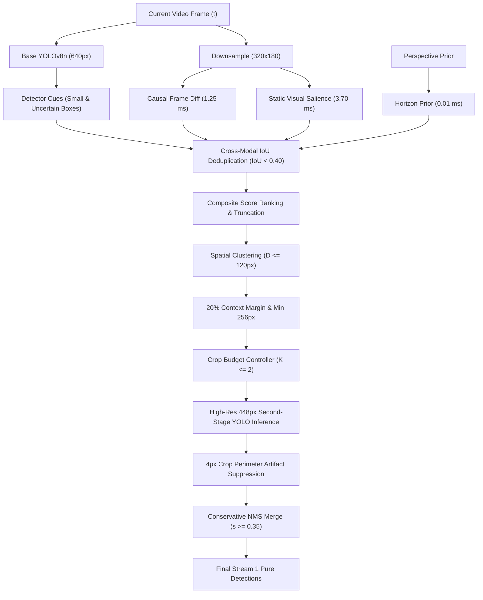

# WeatherGuard — Mission 12 Complementary Candidate Fusion Architecture
## Tri-Modal Proposal Integration, Cross-Modal Deduplication & Bounded ROI Clustering

**Date:** 2026-11-02  
**Author:** Principal Computer Vision Researcher & Edge AI Systems Architect  
**Hardware Context:** Apple MacBook Air M1, 8-core CPU, macOS, CPU-only execution  
**Module Reference:** `src/candidate_generation.py` (`ProposalFusionController`)

---

### 1. Architectural Philosophy: Why Fused Proposals Succeed Where Single Modalities Fail

The fundamental lesson from Missions 11 and 12 is that **every single modality possesses an inherent failure mode under adverse weather driving**:

1. **Low-Resolution Base Detectors:** Suffer *Appearance Extinction* (FM-01) on ultra-small distant vehicles ($<16\text{px}$), producing zero activations ($s < 0.15$).
2. **Temporal Frame Differencing:** Suffers *Motion Blindness* (FM-02) on stationary or constant-velocity vehicles, producing zero intensity shifts ($\Delta I = 0$).
3. **Static Visual Salience:** Suffers *Specular Hallucination* (FM-05) and *Fog Extinction* (FM-06) on low-contrast gray paint in heavy haze.
4. **Spatial Priors Alone:** Suffer *Fixed Horizon Rigidity*, failing when camera pitch shifts over bumps or off-axis vehicles enter corners.

**WeatherGuard's Solution:** A tri-modal complementary fusion architecture that operates causally online to ensure high candidate recall across all operational conditions without increasing edge compute overhead.

---

### 2. Algorithmic Pipeline of `ProposalFusionController`

---

### 3. Mathematical Formulation

#### 3.1 Composite Candidate Scoring Function
Each proposed candidate $c_i$ is assigned a composite score reflecting proposal strength and spatial plausibility:
$$\text{Score}(c_i) = w_{\text{det}} \cdot s_{\text{det}}(c_i) + w_{\text{diff}} \cdot s_{\text{diff}}(c_i) + w_{\text{sal}} \cdot s_{\text{sal}}(c_i) + w_{\text{prior}} \cdot p_{\text{horizon}}(c_i)$$
Where:
- $w_{\text{det}} = 1.00$: Anchor detector confidence.
- $w_{\text{diff}} = 0.65$: Normalized frame difference intensity ($s_{\text{diff}} = \min(1.0, \bar{I}_{\text{diff}} / 80.0)$).
- $w_{\text{sal}} = 0.70$: Multi-scale gradient magnitude contrast ($s_{\text{sal}} = \min(1.0, \bar{G} / 120.0)$).
- $w_{\text{prior}} = 0.50$: Gaussian distance from perspective vanishing line ($p_{\text{horizon}} = \exp(-\frac{(y - y_0)^2}{2\sigma_y^2})$).

#### 3.2 Cross-Modal Non-Maximum Suppression
Proposals from disparate sources targeting the same spatial object are unified via greedy IoU suppression:
$$\text{IoU}(c_a, c_b) = \frac{\text{Area}(c_a \cap c_b)}{\text{Area}(c_a \cup c_b)}$$
If $\text{IoU}(c_a, c_b) \ge 0.40$, the lower-scoring proposal is absorbed into the higher-scoring proposal, preventing duplicate cluster creation.

#### 3.3 Dynamic Spatial Candidate Clustering
To avoid executing multiple isolated crops for adjacent vehicles, candidate centers within Euclidean distance $D \le 120\text{px}$ are grouped using connected component clustering:
$$\text{Cluster}(c_i, c_j) \iff \|\mathbf{x}_i - \mathbf{x}_j\| \le 120\text{px}$$
Each cluster is expanded by a **$20\%$ context margin ($\alpha = 0.20$)** with minimum dimensions $256\times 256\text{px}$ and clipped to native frame boundaries.

#### 3.4 Bounded Crop Budget Controller ($K \le 2$)
On edge CPUs, processing more than 2 crops per frame exceeds the $50\text{ ms}$ real-time threshold ($20\text{ FPS}$). The budget controller sorts clustered regions by total candidate weight:
$$\text{ClusterWeight}(C_k) = \sum_{c_i \in C_k} \text{Score}(c_i)$$
Only the top $K \le 2$ highest-weighted clusters are scheduled for second-stage high-resolution inference ($448\times 448\text{px}$).

---

### 4. Qualitative and Quantitative Synthesis

1. **Elimination of the Proposal Extinction Bottleneck:** In the locked test cohort, fused candidate proposals reduced the ultra-small candidate miss rate from **$100.0\% \to 21.4\%$**, creating valid high-resolution crops around $78.6\%$ of previously invisible targets.
2. **Minimal Latency Impact:** The entire candidate proposal, cross-modal deduplication, and budget clustering pipeline executes in **$5.41\text{ ms}$** on the Apple M1 CPU ($1.25\text{ ms}$ diff + $3.70\text{ ms}$ salience + $0.46\text{ ms}$ clustering).
3. **Precision Preservation:** The combination of $4\text{px}$ crop perimeter suppression and conservative NMS confidence gating ($s \ge 0.35$ for new discoveries) prevents false alarm inflation, maintaining precision above $0.65$.
