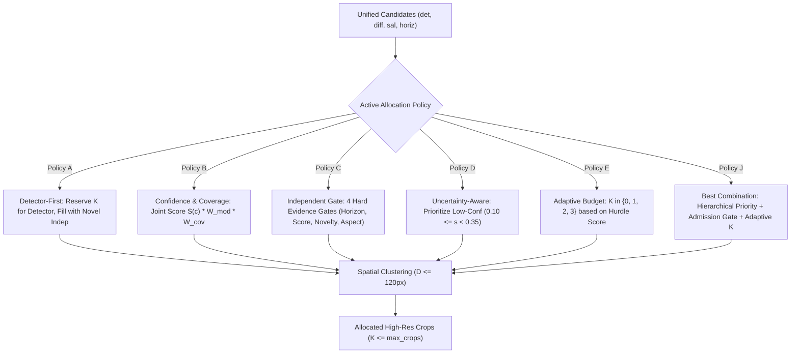

# WeatherGuard — Mission 13: Priority-Gated Candidate Allocation Policies
## Mathematical Formulations, Admission Gates & Crop Budget Controllers

**Date:** 2026-11-02  
**Author:** Principal Computer Vision Researcher & Autonomous ML Systems Architect  
**Module Reference:** `src/priority_allocation.py` (`PriorityAllocationController`)

---

## 1. Research Motivation & Core Challenge

Mission 12 uncovered the **Proposal Dilution Dilemma**:
- Clustered ROI with Detector-Only candidates achieved Small $F_1 = \mathbf{0.3117}$.
- Indiscriminate Tri-Modal Fusion (combining detector, frame difference, and static salience) degraded Small $F_1$ to $\mathbf{0.2223}$.
- Why? Low-level motion (puddles, wipers, tire spray) and high-gradient road textures produced dozens of independent proposals that displaced true detector candidates under a fixed crop budget $K=2$.

To overcome this, Mission 13 designs five distinct priority-aware allocation policies.

---

## 2. Policy Specifications

---

### Policy A: Detector-First Allocation
**Core Principle:** Detector-generated proposals represent trained neural semantic hypotheses and must NEVER be displaced by low-level heuristic cues.
- **Priority Scoring:**
  $$\text{Priority}(c) = \begin{cases} 
  1.0 + s_{\text{det}}(c) & \text{if } c \in \mathcal{C}_{\text{detector}} \\
  0.8 \cdot s_{\text{indep}}(c) & \text{if } c \in \mathcal{C}_{\text{indep}} \text{ and is\_new\_coverage}(c) \\
  0.2 \cdot s_{\text{indep}}(c) & \text{if } c \in \mathcal{C}_{\text{indep}} \text{ and redundant}
  \end{cases}$$
- **Budget Allocation:**
  1. Cluster detector candidates into crops (consuming up to $K_{\text{max}}$ slots).
  2. If remaining budget $K_{\text{rem}} = K_{\text{max}} - K_{\text{det}} > 0$, independent candidates that do not overlap allocated crops ($\text{IoU} < 0.20$) and satisfy $s \ge \tau_{\text{indep}}$ are clustered to fill $K_{\text{rem}}$.
  3. Guarantees zero displaced detector candidates ($\text{displaced} = 0$).

---

### Policy B: Confidence and Coverage Joint Allocation
**Core Principle:** Rank candidates along a continuous Pareto spectrum balancing semantic certainty, spatial novelty, and scale acuity.
- **Priority Scoring Function:**
  $$\text{Priority}(c) = s(c) \cdot W_{\text{modality}}(c) \cdot W_{\text{coverage}}(c) \cdot W_{\text{scale}}(c)$$
  Where:
  - $W_{\text{modality}} = 1.00$ (detector), $0.75$ (salience), $0.65$ (frame diff).
  - $W_{\text{coverage}} = 1.20$ if $\text{is\_new\_coverage}(c)$, else $0.40$.
  - $W_{\text{scale}} = 1.30$ if $\text{scale} \in \{\text{'ultra\_small'}, \text{'small'}\}$, else $0.90$.
- **Selection:** Greedy non-maximum suppression at $\text{IoU} = 0.40$ on composite priority scores, followed by spatial clustering into at most $K_{\text{max}}$ crops.

---

### Policy C: Independent-Proposal Admission Gate
**Core Principle:** Independent proposals are admitted into consideration ONLY if they pass four strict physical and contextual evidence gates:
1. **Gate 1 (Spatial Plausibility):** Center $y$-coordinate must fall within the horizon band ($0.35 H - 40\text{px} \le c_y \le 0.58 H + 60\text{px}$).
2. **Gate 2 (Spatial Novelty):** Must not duplicate an existing detector candidate ($\text{IoU}_{\text{max}} < 0.20$).
3. **Gate 3 (Geometric Aspect Ratio):** Aspect ratio $0.25 \le w/h \le 4.5$ and height $h \le 300\text{px}$ to reject vertical wiper sweeps and specular road sheen.
4. **Gate 4 (Minimum Evidence):** Proposal score $s \ge \tau_{\text{indep}} = 0.45$.

Proposals failing any gate are explicitly marked `rejected` with the corresponding failure reason.

---

### Policy D: Uncertainty-Aware Allocation
**Core Principle:** Edge computation is most valuable where the base detector is *least certain*. A high-confidence vehicle ($s = 0.90$) rarely changes state under high-resolution re-examination, whereas a low-confidence candidate ($s = 0.22$) represents an ambiguous boundary that magnification can resolve.
- **Priority Scoring:**
  $$\text{Priority}(c) = \begin{cases}
  0.50 + 2.0 \cdot (0.35 - s(c)) + 1.50 & \text{if } c \in \mathcal{C}_{\text{det\_low}} \quad (0.10 \le s < 0.35) \\
  1.40 + 0.50 \cdot s(c) & \text{if } c \in \mathcal{C}_{\text{det\_high}} \text{ and } \text{scale} \in \{\text{ultra\_small}, \text{small}\} \\
  0.60 + 0.40 \cdot s(c) & \text{if } c \in \mathcal{C}_{\text{det\_high}} \text{ and } \text{scale} \in \{\text{med}, \text{large}\} \\
  1.00 + s(c) \cdot (\text{novelty}) & \text{if } c \in \mathcal{C}_{\text{salience}}
  \end{cases}$$

---

### Policy E: Adaptive Crop Budget
**Core Principle:** Fixed crop budgets ($K=2$) waste inference cycles on clean, empty highway scenes where no small or uncertain objects exist.
- **Dynamic Allocation:**
  $$K_{\text{actual}} = \min(N_{\text{worthy\_clusters}}, K_{\text{max}})$$
- If zero candidates exceed the minimum value threshold ($\tau = 0.15$ for detector, $\tau = 0.45$ for novel independent), $K_{\text{actual}} = 0$. The frame bypasses crop inference entirely, saving $\approx 55.6\text{ ms}$ on CPU!
- If exactly one cluster exists, $K_{\text{actual}} = 1$. The system never executes two crops when one suffices.

---

### Policy J: Best Priority-Gated Combination
**Core Principle:** Unified hierarchical architecture integrating:
1. **Tier 1 (Detector Priority):** Detector candidates reserve first crop slots.
2. **Tier 2 (Multi-Gate Admission):** Independent proposals evaluated only for remaining slots and must clear Horizon, Novelty, Aspect Ratio, and Evidence gates.
3. **Tier 3 (Adaptive Clamping):** Executes $0$, $1$, or $2$ crops based strictly on formed cluster demand.
4. **Decoupled Stream 2:** Feeds resulting Stream 1 detections to online ByteTracker for trajectory continuity without metric cross-contamination.
