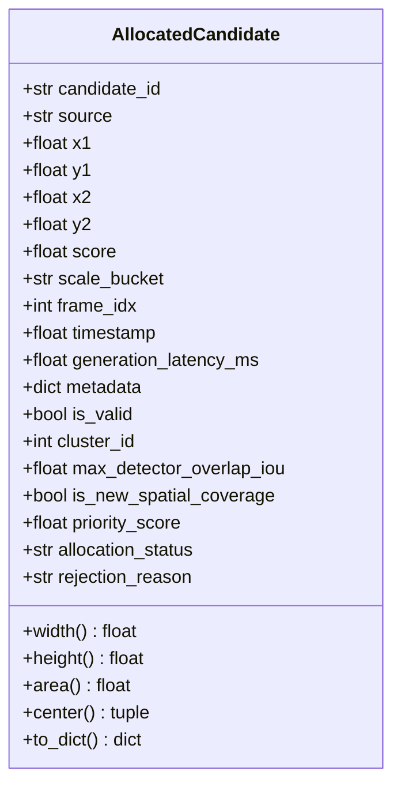

# WeatherGuard — Mission 13: Common Candidate Representation Schema
## Unified Multi-Modal Candidate Data Structure & Provenance Architecture

**Date:** 2026-11-02  
**Author:** Principal Computer Vision Researcher & Edge Inference Systems Architect  
**Module Reference:** `src/priority_allocation.py` (`AllocatedCandidate`, `CropAllocationDecision`)

---

## 1. Architectural Motivation

In Mission 12, candidate proposals generated by different modalities (YOLO detector, frame differencing, static visual salience, and horizon priors) were handled with heterogeneous attributes, lacking a standardized provenance trail. This made it impossible to audit *why* a proposal was accepted, *which* detector candidates were displaced, and *whether* an independent proposal provided genuinely novel spatial coverage.

Mission 13 establishes `AllocatedCandidate`, a unified, schema-validated representation that enforces consistent coordinate geometry, temporal indexing, spatial scale classification, provenance tracking, and explicit allocation status.

---

## 2. Formal Schema Specification

### 2.1 Field Definitions

| Field Name | Data Type | Permitted Values | Definition & Invariants |
|---|---|---|---|
| `candidate_id` | `str` | `det_*`, `diff_*`, `sal_*`, `horiz_*` | Unique alphanumeric identifier scoped to the current frame. |
| `source` | `str` | `'detector_high'`, `'detector_low'`, `'frame_diff'`, `'static_salience'`, `'spatial_horizon'` | Exact provenance modality generating the bounding proposal. |
| `x1, y1, x2, y2` | `float` | $0.0 \le x_1 < x_2 \le W$, $0.0 \le y_1 < y_2 \le H$ | Absolute pixel coordinates in original frame reference space ($1280\times 720$). |
| `score` | `float` | $[0.0, 1.0]$ | Raw modality confidence score (detector softmax probability or normalized gradient/motion intensity). |
| `scale_bucket` | `str` | `'ultra_small'`, `'small'`, `'medium'`, `'large'` | Spatial scale category defined by bounding area ($\text{px}^2$). |
| `frame_idx` | `int` | $\ge 0$ | Monotonically increasing sequence frame index. |
| `timestamp` | `float` | Unix timestamp | Wall-clock creation timestamp. |
| `generation_latency_ms`| `float` | $\ge 0.0$ | Time taken by the upstream generator to produce this proposal batch. |
| `metadata` | `dict` | Arbitrary JSON | Upstream diagnostics (e.g. `class_name`, `raw_grad`, `motion_speed`). |
| `is_valid` | `bool` | `True`, `False` | Geometric sanity flag (ensures $w > 0, h > 0$). |
| `cluster_id` | `int` / `None` | Integer ID or None | Index of the crop cluster into which this candidate was merged. |
| `max_detector_overlap_iou` | `float` | $[0.0, 1.0]$ | Maximum Intersection-over-Union with any concurrent detector candidate. |
| `is_new_spatial_coverage` | `bool` | `True`, `False` | `True` if $\text{IoU}_{\text{det}} < 0.20$; indicates candidate explores uncovered scene area. |
| `priority_score` | `float` | $\ge 0.0$ | Composite score assigned by the active allocation policy. |
| `allocation_status` | `str` | `'allocated'`, `'rejected'`, `'suppressed'` | Final allocation outcome under the crop budget. |
| `rejection_reason` | `str` / `None` | Reason string | Explicit audit justification if candidate was rejected. |

---

## 3. Candidate Source Taxonomies

1. **`detector_high`:** Bounding boxes predicted by base YOLOv8n (640px) with confidence $s \ge 0.35$ that fall into small or ultra-small scale buckets ($\text{area} < 2304\text{px}^2$ or $\max(w, h) < 48\text{px}$).
2. **`detector_low`:** Low-confidence detections ($0.10 \le s < 0.35$) from base YOLOv8n representing uncertain objects requiring high-resolution verification.
3. **`frame_diff`:** Connected components extracted from causal inter-frame luminance differencing ($320\times 180$) with morphological filtering and wiper-sweep geometric suppression.
4. **`static_salience`:** Sobel gradient clusters weighted by a Gaussian perspective vanishing-line prior ($y_0 = 0.45 H$) thresholded at the 94th percentile.
5. **`spatial_horizon`:** Structured 3-cell perspective window prior across the road horizon band ($0.35 H \le y \le 0.58 H$).

---

## 4. Scale Disaggregation Standards

Scale categories are strictly defined by bounding box pixel area:
$$\text{Scale}(c) = \begin{cases} 
\text{'ultra\_small'} & \text{if } \text{Area} < 256.0\text{ px}^2 \quad (< 16\text{ px}) \\
\text{'small'} & \text{if } 256.0 \le \text{Area} < 1024.0\text{ px}^2 \quad (16 - 32\text{ px}) \\
\text{'medium'} & \text{if } 1024.0 \le \text{Area} < 9216.0\text{ px}^2 \quad (32 - 96\text{ px}) \\
\text{'large'} & \text{if } \text{Area} \ge 9216.0\text{ px}^2 \quad (\ge 96\text{ px})
\end{cases}$$

---

## 5. Spatial Coverage & Redundancy Accounting

To prevent independent proposals from consuming high-resolution crop slots on regions already covered by the base detector, every candidate computes its maximum IoU with all detector proposals:
$$\text{IoU}_{\text{max}}(c) = \max_{d \in \mathcal{D}_{\text{detector}}} \text{IoU}(\text{Box}(c), \text{Box}(d))$$
A proposal is marked as contributing **novel spatial coverage** if:
$$\text{is\_new\_spatial\_coverage}(c) = \begin{cases} \text{True} & \text{if } \text{IoU}_{\text{max}}(c) < 0.20 \\ \text{False} & \text{otherwise} \end{cases}$$
Redundant independent proposals ($\text{IoU} \ge 0.20$) receive downweighted priority or hard rejection, resolving the proposal dilution dilemma identified in Mission 12.
