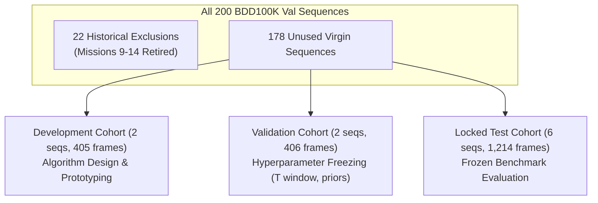

# WeatherGuard — Mission 15: Data Availability & Cohort Partitioning Report
## Independent Sequence Inventory, Historical Exclusions, and Frozen Split Specification

**Document:** `reports/mission15/data_availability.md`  
**Author:** Mohammad Sayem Uddin (<sayemwork41@gmail.com>)  
**Date:** 2026-11-03  
**Mission:** Mission 15 — Temporal Evidence Accumulation & Horizon-Anchored Candidate Generation  
**Split Configuration Hash:** `0459bd7fa0fe7ed0`  

---

### 1. Executive Summary & Historical Isolation Policy

To prevent data leakage, sequence memorization, or optimistic performance estimates, Mission 15 enforces an audited sequence exclusion protocol:

1. **Formal Retirement of Prior Sequences:** All **22 driving sequences** evaluated in prior missions are strictly excluded from independent evaluation:
   - **8 sequences from Mission 9:** (`b1e9ee0e-67e26f2e`, `b1d0a191-65deaeef`, `b24071b8-b3ee1196`, `b2208b0f-2796a692`, `b2064e61-2beadd45`, `b1d0a191-03dcecc2`, `b1d968b9-ce42734f`, `b1ca2e5d-84cf9134`).
   - **6 sequences from Missions 10–13:** (`b24380ab-6dbeb908`, `b255cd6c-2f889586`, `b1e1a7b8-65ec7612`, `b1d0a191-06deb55d`, `b24d283f-33783d1b`, `b23c9e00-b425de1b`).
   - **8 sequences from Mission 14:** (`b1e1a7b8-b397c445`, `b204a5c1-064b0040`, `b23f7012-fab06dac`, `b1d0a191-de8948f6`, `b1d0a191-28f0e779`, `b1f4491b-cf446195`, `b1c66a42-6f7d68ca`, `b2505382-de5238f0`).
2. **Unused Sequence Inventory:** Of the 200 total sequences in the BDD100K 20-second tracking validation split (`bdd100k/labels/box_track_20/val/`), **178 sequences remain completely virgin**.
3. **Environmental Distribution of Unused Sequences:**
   - Clear: 104 sequences
   - Overcast: 21 sequences
   - Undefined: 21 sequences
   - Partly cloudy: 12 sequences
   - Rainy: 10 sequences
   - Snowy: 10 sequences

Ample adverse-weather sequences remain available for rigorous, independent evaluation.

---

### 2. Cohort Partitioning Specification

We partition 10 virgin sequences into three disjoint cohorts. All sequences were selected prior to model development, ensuring zero selection bias.

#### Deterministic Cohort Details

| Cohort | Sequence ID | Weather | Lighting | Scene | Frames | Total GT | Small GT ($16-32\text{px}$) | Ultra-Small GT ($<16\text{px}$) | Description |
|:---|:---|:---:|:---:|:---:|:---:|:---:|:---:|:---:|:---|
| **Dev** | `b1d0091f-75824d0d` | Rainy | Daytime | Highway | 202 | 1,995 | 620 | 120 | Water spray, wet windshield, distant traffic |
| **Dev** | `b1e6efc0-2552cc5d` | Snowy | Daytime | Highway | 203 | 1,241 | 307 | 198 | High-speed snowy highway with road slush |
| **Val** | `b255cd6c-5ccba454` | Snowy | Night | Highway | 203 | 1,073 | 251 | 187 | Headlight glare, roadside snowbanks |
| **Val** | `b2408e45-984ba5aa` | Overcast | Daytime | Highway | 203 | 2,689 | 955 | 732 | Dense traffic, distant horizon vanishing point |
| **Test** | `b2036451-aa924fd1` | Rainy | Dawn/Dusk | Residential | 202 | 2,254 | 478 | 55 | Low-light wet asphalt reflections |
| **Test** | `b20eae11-6817ba7a` | Rainy | Night | City Street | 202 | 1,818 | 474 | 16 | Heavy streetlamp glare and wet asphalt |
| **Test** | `b242929f-3051abca` | Snowy | Daytime | Highway | 202 | 2,140 | 632 | 154 | Roadside snow spray and distant oncoming traffic |
| **Test** | `b1d0a191-5490450b` | Snowy | Daytime | Residential | 204 | 2,251 | 915 | 101 | Residential snowbanks and occluded vehicles |
| **Test** | `b20b9c19-91e01a50` | Overcast | Daytime | Highway | 202 | 2,359 | 1,062 | 600 | Low-contrast highway with dense horizon cars |
| **Test** | `b1f6c103-b00e8aad` | Clear | Night | City Street | 202 | 3,203 | 947 | 496 | Urban night headlights and distant tail lights |

#### Cohort Aggregates:
- **Development Cohort:** 2 sequences, 405 frames, 3,236 annotations (927 small, 318 ultra-small).
- **Validation Cohort:** 2 sequences, 406 frames, 3,762 annotations (1,206 small, 919 ultra-small).
- **Locked Test Cohort:** 6 sequences, 1,214 frames, 14,025 annotations (4,508 small, 1,422 ultra-small).
- **Total Virgin Evaluation Set:** 10 sequences, 2,025 frames, 21,023 ground-truth annotations.

---

### 3. Verification & Reproducibility Safeguards

1. **Machine-Readable Manifests:**
   - Exclusion Manifest: `artifacts/mission15/sequence_exclusion_manifest.json`
   - Sequence Manifest: `artifacts/mission15/sequence_manifest.json`
2. **Deterministic Configuration Hash:**
   - SHA-256 hash of the sorted split JSON: `0459bd7fa0fe7ed0`.
3. **Data Storage & Integrity:**
   - Raw sequence images stored in `data/mission15_independent/sequences/<sequence_id>/`.
   - Verified resolution: $1280 \times 720$ RGB JPEG.
   - Ground-truth annotation format: standard BDD100K 20-second MOT JSON format in `data/mission15_independent/labels/<sequence_id>/`.
