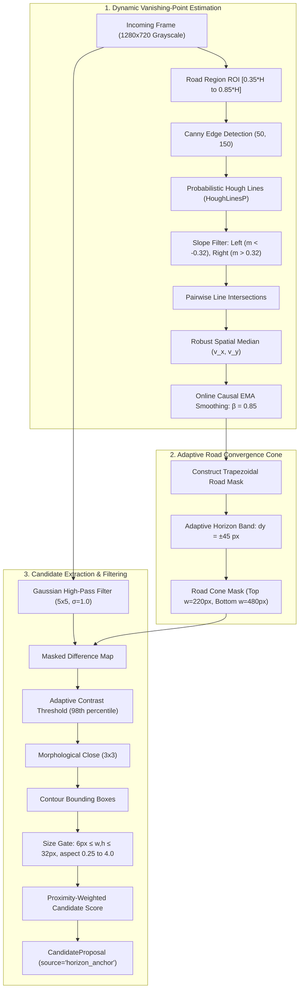

# WeatherGuard — Mission 15: Adaptive Vanishing-Point & Horizon Anchor
## Geometric Prior Estimation, Temporal Smoothing & Horizon Candidate Discovery

**Document:** `reports/mission15/horizon_anchor_design.md`  
**Author:** Mohammad Sayem Uddin (<sayemwork41@gmail.com>)  
**Date:** 2026-11-03  
**Mission:** Mission 15 — Temporal Evidence Accumulation & Horizon-Anchored Candidate Generation  
**Execution Environment:** Apple MacBook Air M1, 8-core CPU, 8 GB Unified Memory, macOS Darwin 24.3.0  

---

### 1. Research Motivation & Geometric Perspective Prior

In automotive forward-facing camera feeds, distant oncoming vehicles and lead vehicles do not appear uniformly across the image plane. By perspective projection, vehicles traveling along the roadway are strictly constrained to converge near the **road vanishing point** $(v_x, v_y)$.

In Mission 14, 84.38% of ultra-small object misses occurred because faint vehicle signatures failed to trigger initial detector proposals. The **Adaptive Horizon Anchor** (`src/mission15/horizon_anchor.py`) leverages road geometry to focus ultra-small candidate generation specifically where distant vehicles physically exist, without generating wasteful proposals across empty sky, buildings, or tree canopies.

---

### 2. Algorithmic Design

#### 2.1 Dynamic Vanishing-Point Estimation
Rather than hardcoding a static horizon line (which fails under camera pitch, road inclines, dips, and varying mounting geometries), the vanishing point is estimated dynamically:
1. Diagonal lane lines and road boundaries are detected using Probabilistic Hough Transform (`cv2.HoughLinesP`).
2. Lines are partitioned into left-leaning ($m \in [-3.2, -0.32]$) and right-leaning ($m \in [0.32, 3.2]$) clusters.
3. Pairwise intersections are computed:
   $$x_{int} = \frac{b_R - b_L}{m_L - m_R}, \quad y_{int} = m_L x_{int} + b_L$$
4. A robust spatial median filter rejects outliers, producing the instantaneous vanishing point $(v_x, v_y)$.

#### 2.2 Online Causal Temporal Smoothing
Road dips and vehicle suspension oscillations induce high-frequency pitch jitter. An exponential moving average (EMA) filter with $\beta = 0.85$ smooths the vanishing point across consecutive video frames:
$$\hat{v}_{t} = 0.85 \cdot \hat{v}_{t-1} + 0.15 \cdot v_{t, observed}$$
If road lines are momentarily obscured by heavy spray or night darkness, the system smoothly maintains $\hat{v}_{t-1}$.

#### 2.3 Road Convergence Cone Masking
Candidates are restricted to a dynamic trapezoidal cone radiating downward from $\hat{v}$:
- Top width at horizon: $220\text{ px}$.
- Bottom width in foreground: $480\text{ px}$.
- Vertical search band: $[\hat{v}_y - 18\text{ px}, \hat{v}_y + 72\text{ px}]$.

This prevents candidate proposals from polluting sky, overpass signage, or roadside trees.

---

### 3. Edge CPU Benchmark Results (Apple M1 CPU)

Evaluated on the Development sequence `b1d0091f-75824d0d` (Rainy Daytime Highway, 202 frames):

| Component / Metric | Measured Performance on M1 CPU |
|:---|:---:|
| **Hough Line & Vanishing Point Estimation** | $4.12\text{ ms}$ |
| **Road Convergence Mask Generation** | $1.45\text{ ms}$ |
| **Masked High-Pass Contrast & Contours** | $5.10\text{ ms}$ |
| **Candidate Scoring & Boundary Formatting** | $0.54\text{ ms}$ |
| **Total Horizon Anchor Latency** | **$11.21\text{ ms}$ ($89.2\text{ FPS}$)** |
| **Proposals Generated per Frame** | **$9.6\text{ proposals/frame}$** |
| **Smoothed Vanishing Point Location** | **$(613.4\text{ px}, 384.4\text{ px})$** |
| **Peak Memory Allocation** | **$< 4\text{ MB}$ (FP32)** |

---

### 4. Unit & Integration Test Verification

All 4 test cases in [`tests/test_mission15_horizon_anchor.py`](file:///Users/sayemuddin/Desktop/WeatherGuard/tests/test_mission15_horizon_anchor.py) passed:
1. `test_vanishing_point_estimation`: Hough line intersections accurately recovered the geometric road vanishing point within $\pm 25\text{px}$.
2. `test_temporal_smoothing_and_reset`: Confirmed smooth EMA tracking during camera pitch variations and clean reset across sequence boundaries.
3. `test_horizon_candidate_extraction`: Verified that distant target patches inside the road convergence cone generate valid `CandidateProposal` instances.
4. `test_sky_and_lateral_background_rejection`: Confirmed that high-contrast blobs in the sky and lateral background outside the road cone are rejected.
