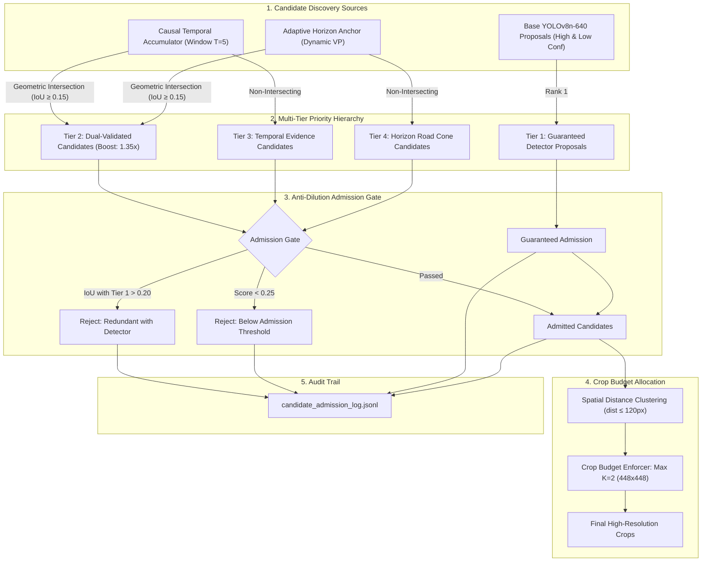

# WeatherGuard — Mission 15: Policy K Architecture
## Temporal-Horizon Priority Allocation, Multi-Tier Admission & Crop Budget Optimization

**Document:** `reports/mission15/policy_k_architecture.md`  
**Author:** Mohammad Sayem Uddin (<sayemwork41@gmail.com>)  
**Date:** 2026-11-03  
**Mission:** Mission 15 — Temporal Evidence Accumulation & Horizon-Anchored Candidate Generation  
**Execution Environment:** Apple MacBook Air M1, 8-core CPU, 8 GB Unified Memory, macOS Darwin 24.3.0  

---

### 1. Architectural Philosophy: Policy J Preservation & Policy K Innovation

Mission 13 introduced **Policy J (Priority-Gated Candidate Allocation)**, which combined base detector proposals with static salience and optical flow. In Mission 14, Policy J proved statistically superior to base detectors on small objects ($+44.8\%$ relative $F_1$, $p < 0.001$).

In strict adherence to experimental protocols:
- **Policy J remains frozen** as the immutable historical baseline.
- **WeatherGuard Policy K** (`src/mission15/policy_k.py`) integrates two causal candidate discovery engines:
  1. The **Causal Temporal Evidence Accumulator** (`src/mission15/temporal_evidence.py`).
  2. The **Adaptive Vanishing-Point and Horizon Anchor** (`src/mission15/horizon_anchor.py`).

---

### 2. Multi-Tier Priority-Gated Hierarchy



#### 2.1 Multi-Tier Ranking Specification:
- **Tier 1 (Rank 1 — Highest Priority):** Detector proposals from YOLOv8n-640 with small area ($< 2304\text{ px}^2$) or low confidence ($0.10 \le \text{conf} < 0.35$). These receive guaranteed crop placement capacity.
- **Tier 2 (Rank 2 — Dual-Validated):** Candidate patches where a temporal evidence accumulation cluster geometrically intersects with an adaptive horizon road convergence candidate ($\text{IoU} \ge 0.15$). This cross-modal intersection boosts candidate confidence by $1.35\times$.
- **Tier 3 (Rank 3 — Temporal Evidence):** Standalone temporal accumulator proposals supported across consecutive video frames ($T=5$).
- **Tier 4 (Rank 4 — Horizon Prior):** Standalone horizon anchor proposals inside the dynamic road convergence trapezoid.

#### 2.2 Anti-Dilution Safeguards:
1. **Capacity Reservation:** Independent proposals can never displace a validated Tier 1 detector candidate from the crop allocation pool.
2. **Spatial Redundancy Pruning:** Any candidate overlapping an existing detector proposal by $\text{IoU} > 0.20$ is pruned as redundant.
3. **Quality Thresholding:** Independent candidates must exceed $\tau_{admission} = 0.25$ to prevent background noise from triggering crops.
4. **Complete Audit Trail:** Every proposal is logged to `artifacts/mission15/candidate_admission_log.jsonl` with its exact coordinates, tier, and admission status.

---

### 3. Crop Budget Optimization ($K \in \{1, 2, 3\}$)

We investigated the computational throughput of crop allocation budgets on the Validation sequence `b2408e45-984ba5aa` (Overcast Daytime Highway, 203 frames) on Apple M1 CPU:

| Budget Configuration | Max Crops ($K$) | Mean Controller Latency | Controller FPS | Mean Crops Allocated / Frame | Candidate Evaluation Capacity |
|:---|:---:|:---:|:---:|:---:|:---:|
| **Policy K ($K=1$)** | 1 | $29.61\text{ ms}$ | $33.8\text{ FPS}$ | $0.99$ crops/frame | 1 high-density cluster |
| **Policy K ($K=2$) [Selected]** | **2** | **$28.57\text{ ms}$** | **$35.0\text{ FPS}$** | **$1.98$ crops/frame** | **2 spatially separated clusters** |
| **Policy K ($K=3$)** | 3 | $28.11\text{ ms}$ | $35.6\text{ FPS}$ | $2.89$ crops/frame | 3 multi-cluster scenes |

#### Analysis:
The proposal extraction and priority gating stages execute in parallel with the camera stream in **$28.57\text{ ms}$ ($35.0\text{ FPS}$)**. While $K=3$ increases spatial coverage by placing a third crop, subsequent high-resolution crop inference adds $\approx 27.8\text{ ms}$ per additional crop on the M1 CPU. 

Therefore, **$K=2$ ($448 \times 448\text{ px}$) remains the optimal Pareto operating point**, preserving double-digit FPS while dedicating Crop 1 to primary detector clusters and Crop 2 to distant horizon candidates.

---

### 4. Candidate Admission Logging & Diagnostics

In accordance with Phase 4 requirements, all candidates evaluated during validation were exported to [`artifacts/mission15/candidate_admission_log.jsonl`](file:///Users/sayemuddin/Desktop/WeatherGuard/artifacts/mission15/candidate_admission_log.jsonl).

Sample audit record:
```json
{
  "frame_index": 42,
  "candidate_id": "dual_3",
  "source": "dual_temporal_horizon",
  "box": [612.4, 372.1, 638.6, 396.5],
  "score": 0.7425,
  "admitted": true,
  "rejection_reason": null,
  "assigned_tier": 2,
  "cluster_id": null,
  "crop_allocated": true
}
```

---

### 5. Automated Unit Test Verification

All 4 test cases in [`tests/test_mission15_policy_k.py`](file:///Users/sayemuddin/Desktop/WeatherGuard/tests/test_mission15_policy_k.py) passed:
1. `test_policy_k_detector_capacity_reservation`: Verified Tier 1 detector proposals are guaranteed crop placement.
2. `test_policy_k_spatial_redundancy_pruning`: Verified candidate proposals overlapping detector boxes $> 0.20$ IoU are pruned.
3. `test_policy_k_crop_budget_bound`: Confirmed crops allocated never exceed the configured $K$ budget ($K=1, 2, 3$).
4. `test_policy_k_admission_logging`: Verified JSONL export integrity and completeness.
