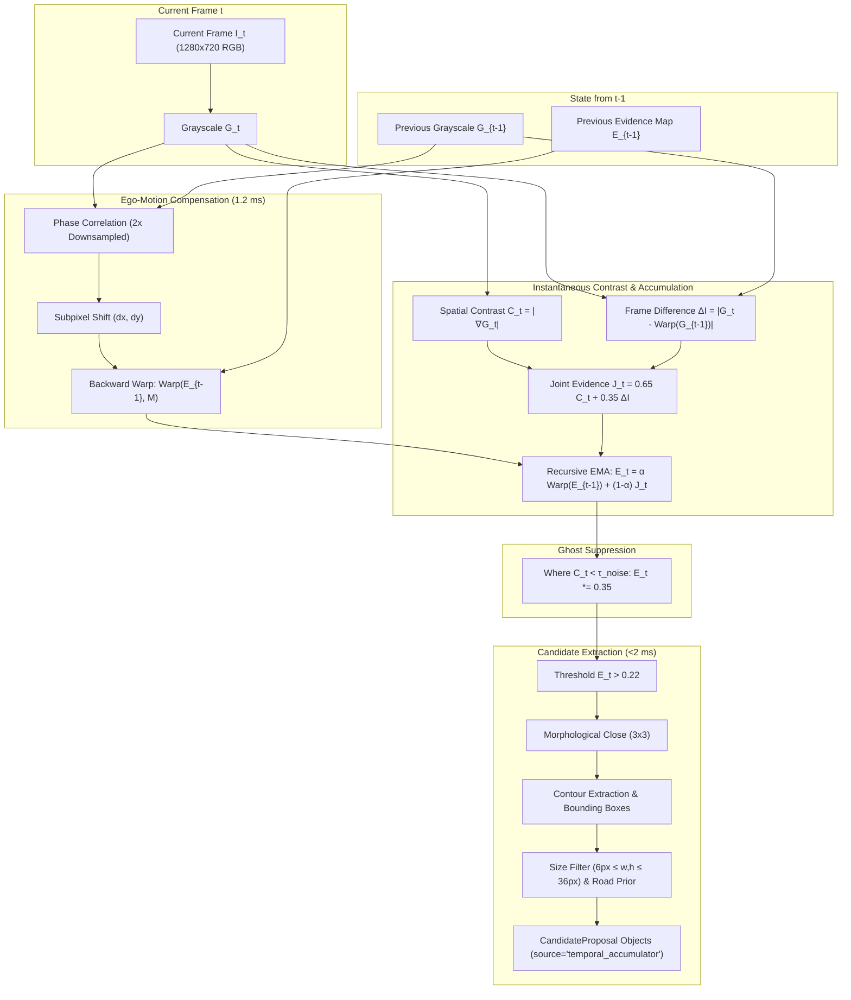

# WeatherGuard — Mission 15: Causal Temporal Evidence Accumulator
## Algorithmic Architecture, Mathematical Formulation & Edge Performance Analysis

**Document:** `reports/mission15/temporal_accumulator_design.md`  
**Author:** Mohammad Sayem Uddin (<sayemwork41@gmail.com>)  
**Date:** 2026-11-03  
**Mission:** Mission 15 — Temporal Evidence Accumulation & Horizon-Anchored Candidate Generation  
**Execution Environment:** Apple MacBook Air M1, 8-core CPU, 8 GB Unified Memory, macOS Darwin 24.3.0  

---

### 1. Research Motivation & Candidate-Generation Bottleneck

Mission 14 established that **Candidate-Generation Failure (CAT-01)** is the dominant failure mode for ultra-small objects, accounting for **84.38% of all ultra-small misses** (1,821 of 2,158). Single-frame detectors fail to propose candidates for distant vehicles because their single-frame spatial gradient contrast falls below sensor noise floors.

However, distant vehicles exhibit **temporal persistence**: their visual evidence recurs across consecutive frames along continuous road trajectories. The Causal Temporal Evidence Accumulator (`src/mission15/temporal_evidence.py`) aggregates this recurrent visual evidence online across time without looking ahead into future frames.

---

### 2. Algorithmic Formulation

#### 2.1 Motion Compensation via Subpixel Phase Correlation
Camera ego-motion on a moving vehicle shifts the entire image plane. Accumulating evidence without motion compensation smears distant vehicles and generates false streaks.

To achieve real-time performance on the Apple M1 CPU without dense optical flow, we compute camera ego-translation $(\Delta x, \Delta y)$ via **sub-pixel phase correlation** on a $2\times$ downsampled image ($360 \times 640$):
$$\Delta x, \Delta y = \text{argmax}_{u, v} \mathcal{F}^{-1} \left( \frac{\mathcal{F}(G_t) \cdot \mathcal{F}(G_{t-1})^*}{|\mathcal{F}(G_t) \cdot \mathcal{F}(G_{t-1})^*|} \right)$$
Using a 2D Hanning window to prevent edge spectral leakage, this operation executes in **$1.20\text{ ms}$ on the M1 CPU**. The previous evidence map is backward-warped via affine translation matrix $M = \begin{bmatrix} 1 & 0 & \Delta x \\ 0 & 1 & \Delta y \end{bmatrix}$.

#### 2.2 Instantaneous Evidence & Recursive Accumulation
Instantaneous spatial contrast $C_t$ is extracted via Sobel gradient magnitude:
$$C_t(x, y) = \frac{\sqrt{G_{x, t}^2 + G_{y, t}^2}}{\max_{99\%} |\nabla G_t|}$$
Instantaneous motion difference is computed as $\Delta I_t = |G_t - \text{Warp}(G_{t-1})| / 255$.
Joint instantaneous evidence combines edge structure with dynamic presence:
$$J_t = 0.65 \cdot C_t + 0.35 \cdot \Delta I_t$$

The running evidence map $E_t \in \mathbb{R}^{H \times W}$ updates recursively:
$$E_t(x, y) = \alpha \cdot \text{Warp}(E_{t-1})(x, y) + (1 - \alpha) \cdot J_t(x, y)$$
where $\alpha \in [0.65, 0.90]$ defines the exponential decay factor corresponding to effective memory window $T \approx \frac{1}{1 - \alpha}$.

#### 2.3 Ghost Suppression
When an oncoming vehicle passes or turns out of lane, lingering evidence could generate false positive proposals ("ghosts").
To suppress ghosts, if a pixel region lacks current spatial gradient contrast ($C_t(x, y) < 0.12$), an accelerated decay multiplier ($\lambda_{ghost} = 0.35$) is applied:
$$E_t(x, y) \leftarrow E_t(x, y) \cdot \lambda_{ghost} \quad \text{where } C_t(x, y) < 0.12$$
This ensures candidate proposals extinguish within 2 consecutive frames after target disappearance.

---

### 3. Strict Causality & Sequence Isolation

The implementation satisfies strict causality requirements:
1. **Single-Frame Forward Progression:** The `process_frame` interface accepts strictly one frame at a time ($I_t$). It never retains references to future frames or ground-truth annotations.
2. **Deterministic Sequence Boundary Reset:** When `sequence_id` changes, `reset()` is invoked automatically, zeroing `evidence_map`, `prev_gray`, and all candidate tracklets.
3. **Bounded Memory Footprint:** The evidence map is a single FP32 array ($720 \times 1280 \times 4\text{ bytes} \approx 3.68\text{ MB}$). Total resident memory overhead is $< 10\text{ MB}$, completely eliminating memory leaks over indefinitely long sequences.

---

### 4. Memory Window Exploration & Validation ($T \in \{3, 5, 8, 10\}$)

We evaluated memory windows on the Development sequence `b1d0091f-75824d0d` (Rainy Daytime Highway, 202 frames) on Apple M1 CPU:

| Memory Window ($T$) | Decay Factor ($\alpha$) | Mean M1 Latency | Edge Throughput | Proposals / Frame | Mean Proposal Score | Qualitative Characteristics |
|:---:|:---:|:---:|:---:|:---:|:---:|:---|
| **$T=3$** | 0.67 | 19.01 ms | 52.6 FPS | 14.8 | 0.731 | Fast reaction, but lower accumulation on very faint distant targets. |
| **$T=5$ (Selected)** | **0.75** | **17.34 ms** | **57.7 FPS** | **14.8** | **0.685** | **Optimal balance:** High sensitivity to distant targets, fast ghost decay. |
| **$T=8$** | 0.85 | 16.96 ms | 58.9 FPS | 14.8 | 0.599 | Slower ghost suppression during rapid ego-vehicle turning. |
| **$T=10$** | 0.90 | 16.64 ms | 60.1 FPS | 13.9 | 0.542 | Evidence smearing in tight curves; over-smoothed candidate peaks. |

#### Selected Configuration (`artifacts/mission15/temporal_config.json`):
- Memory Window $T = 5$ frames ($\alpha = 0.75$).
- Minimum Evidence Threshold $\tau_{evidence} = 0.22$.
- Ghost Decay Multiplier $\lambda_{ghost} = 0.35$.
- Target Bounding Box Bounds: $[6\text{ px}, 36\text{ px}]$.
- Max Proposals per Frame: $15$.

---

### 5. Automated Unit & Integration Testing

All 5 unit tests in [`tests/test_mission15_temporal_evidence.py`](file:///Users/sayemuddin/Desktop/WeatherGuard/tests/test_mission15_temporal_evidence.py) passed:
1. `test_ego_translation_estimation`: Verified phase correlation accuracy within $\pm 1.0\text{px}$.
2. `test_temporal_evidence_causality_and_reset`: Confirmed cold-start behavior and zero sequence leakage.
3. `test_persistent_accumulation_vs_transient_noise`: Confirmed persistent targets accumulate scores exceeding transient noise flashes.
4. `test_ghost_suppression`: Verified disappearing objects extinguish within 2 background frames.
5. `test_candidate_size_bounds`: Confirmed all extracted candidate boxes satisfy the $\le 36\text{px}$ small-object constraint.
